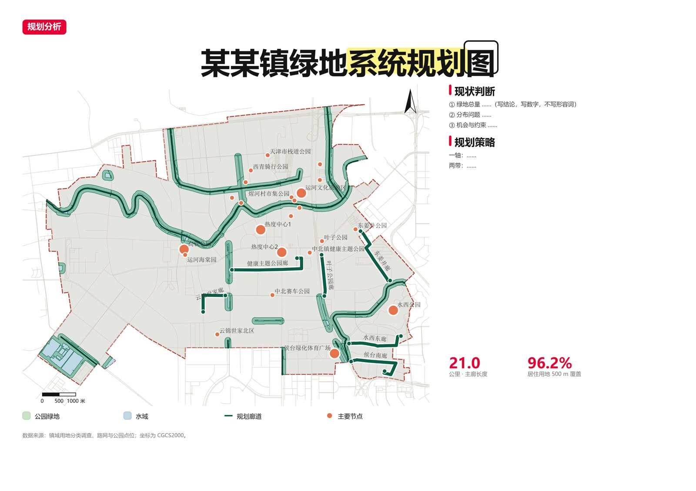

# qgis-board-kit

**QGIS 出素图 + Pillow 排版** 的成套分析图流水线。目标是：一套 12–15 张、风格统一、A3 300dpi 能直接送印的分析图册，改一个数字只重跑一条命令。



> 这张就是 `examples/compose_example.py` 跑出来的东西：A3 横版 4960×3507 @300dpi。

## 为什么是两层

QGIS 的「打印布局」能出图，但做**成套**图册时会一直踩三个坑：

1. **样式是共享的**。为了让某张图的地图淡一点，把 `用地` 层透明度调到 0.3，另外 12 张同源版面的用地全变淡了 —— 而且是在保存工程之后才发现。
2. **排版控制力太弱**。想在标题末尾两个字上画个手绘框、想让图例按 4 个一行铺满底部，布局器里要手调半小时，换一张图又得重来。
3. **可复跑性差**。12 张图的标题、图号、脚注各写一遍；改错一个数字，得一张张回去点。

所以这里把活拆成两半：

```
QGIS（只画地图）                      Pillow（只排版）
  render_map.py                        compose_example.py
  读 JSON spec                         读素图 + 元数据
  ↓                                    ↓
  out/map_xxx.png  ← 素图（无标题无图例）  out/NN_xxx.png  ← 成品展板
  out/map_xxx.json ← extent / mpp
```

好处：地图样式永远不被排版改动（每次渲染都是临时改），文字排版是代码、能批量改、能整册统一；比例尺、指北针、图例位置全部走像素坐标，比布局器里的对齐工具精确。

## 目录

| 路径 | 干什么 |
|---|---|
| `quickstart.py` | 体检：依赖 / 字体 / QGIS 端口 / 当前工程，缺什么直接告诉你 |
| `qgis/mcp_client.py` | 和 QGIS 里那个 MCP 插件说话的 socket 客户端（4 字节长度前缀 + JSON） |
| `qgis/run_qgis.py` | 把一段 PyQGIS 送进**正在运行的 QGIS** 执行，`print` 能回传 |
| `qgis/render_map.py` | 按 JSON spec 渲一张素图 + 元数据（在 QGIS 里跑） |
| `qgis/scale_styles.py` | 出图前把线宽/符号/字号整体乘 k（在 QGIS 里跑） |
| `board/board_lib.py` | 展板排版库：标题、正文、表格、图例、比例尺、指北针、KPI |
| `examples/spec_example.json` | 渲染参数示例（改这里） |
| `examples/compose_example.py` | 排版示例（改这里） |
| `docs/WORKFLOW.md` | 尺度换算、色板、版式网格、交付检查 |
| `docs/PITFALLS.md` | 18 条踩过的坑，每条都写「现象 → 原因 → 修法」 |
| `docs/PROMPTS.md` | 想让 AI 替你改图时，怎么说话 |

## 30 分钟上手

### 1. 装 QGIS 插件（5 分钟）

QGIS ≥ 3.28 → 菜单 `插件 → 管理和安装插件` → 搜 **QGIS MCP** → 安装。
装完在工具栏找到它，**点开**（图标变成实心/提示 listening 才算开）。端口默认 `9876`，本 kit 默认 `9877`：

- 端口被占用时插件会提示，换成 `9877`；
- 或者你直接改本 kit 的环境变量：`set QGIS_MCP_PORT=9876`（PowerShell：`$env:QGIS_MCP_PORT=9876`）。

> 插件是第三方开源项目：<https://github.com/nkarasiak/qgis-mcp>（GPLv2+）。本仓库不包含它的代码，只按它的协议通信。

### 2. 装 Python 依赖（2 分钟）

```bash
pip install -r requirements.txt
```

QGIS 那半边用的是 QGIS 自带的 Python，不用管；本仓库的脚本用系统 Python 跑。

### 3. 体检

```bash
python quickstart.py
```

全绿才往下走。它会告出：字体缺哪个、端口通不通、当前打开的是哪个工程、有多少图层。

### 4. 出第一张素图

先把你的 `.qgz` 在 QGIS 里打开，然后编辑 `examples/spec_example.json`：

```json
{
  "out": "../out/map_example.png",
  "width": 2900, "height": 2300, "dpi": 300,
  "fit": {"layers": ["镇界"], "pad": 0.06},
  "layers": ["节点", "廊道", "底图"]
}
```

- `layers` **上→下**顺序（第一个画在最上面）；留空 = 用当前所有可见图层。
- `fit.layers` 用来算取景范围（留空 = 用 `layers`）；也可以直接给 `extent`。
- 名字写错会报错并把**工程里所有图层名**列出来，照着改就行。

```bash
python qgis/run_qgis.py qgis/render_map.py --spec examples/spec_example.json
```

出 `out/map_example.png` + `out/map_example.json`（含 `mpp`，排比例尺要用）。

### 5. 排一张板

```bash
python examples/compose_example.py
```

`out/001_示例展板.png`，4960×3507。改 `examples/compose_example.py` 顶部的 `CONFIG` 块就能换成你的标题、右栏文字、KPI、图例。

## 批量做一册

一张图 = 一个 `bNN()` 函数 + 一个 spec，照着 `compose_example.py` 复制即可：

```python
def b03():
    board, d = new_board('绿地系统', '某某镇公园绿地规划图', hl=(3, 6))
    panel_ns(board, d, ROOT + 'out/map_green.png', MAPBOX, meta('map_green'))
    y = section(d, RXV, 600, '现状', fs=72)
    y = para(d, RXV, y, '……', fs=42, maxw=RXW, lh=62)
    foot(board, d, '数据来源：……', LEGEND, rows=2)
    save(board, '03公园绿地规划图.png')
```

命名约定：`out/` 里放素图（`map_*.png`）、成品放 `out/` 或你自己的 `成品/` 目录，文件名 `NN四字描述图.png`，排序即图册顺序。

## 版式规范（照抄，别发明）

| 元素 | 规格 |
|---|---|
| 画布 | 4960×3507 px = A3 横版 300dpi；1 mm = 11.81 px |
| 标签 | 左上 `(160,140)` 红色 `(230,0,51)` 圆角药丸，得意黑 60，白字 |
| 标题 | 居中，基线 y=300，得意黑 210，`#141414`；黄块 `(255,230,0)` alpha 120 高亮关键词；末两字外套手绘框 |
| 地图区 | `(160,600)–(3060,2900)`，无边框直接贴，指北针右上、比例尺左下 |
| 右栏 | x=3200 起，文字宽 1520；小标题 = 红色竖条 + 得意黑 72；正文 = 雅黑 42 / 行高 62 |
| KPI | 得意黑 104 红色 + 下方雅黑 40 灰字说明 |
| 图例 | 底部 y=2940 起，每行 4 条，条目字号 44；下一行灰色 38 写数据来源/口径 |
| 配色 | 红 `#E60033`、黄 `#FFE600`、墨 `#141414`、灰 `#787878`、正文 `#3C3C3C` |

字体：标题用**得意黑**（`fonts/SmileySans-Oblique.ttf`，SIL OFL 1.1），正文用系统**微软雅黑**。
没有得意黑时 `board_lib` 会自动退回雅黑粗体——版式不散，但那种「歪着的大字」气质就没了，建议装上。

## 常见故障

| 现象 | 原因 | 修法 |
|---|---|---|
| `连不上 QGIS` | 插件没开 / 端口不对 | QGIS 工具栏点开插件；端口对齐 `QGIS_MCP_PORT` |
| 地图一片白，或跑到非洲去了 | 地图 CRS 和 extent 的数值不是一套 | spec 里显式给 `"crs": "EPSG:4547"`（和你 extent 一致） |
| 线条细得像头发丝 | 屏幕尺度出图 | `"scale": {"k": 2.6}`，见 `docs/WORKFLOW.md` |
| 文字变成方块 | 字体路径不对 | `python quickstart.py` 看字体检查项 |
| QGIS 里图层少了几个 | 内存工程和磁盘 `.qgz` 不一致 | `iface.addProject(路径)` 重新加载，别信 `QgsProject.instance()` |
| `SyntaxError: from __future__ imports must occur at the beginning` | 被注入执行的脚本开头不能有 `from __future__` | 删掉那行（见 `docs/PITFALLS.md`） |

## 许可

代码 MIT（见 `LICENSE`）。随仓库的得意黑字体是 SIL OFL 1.1（见 `fonts/README.md`）。这套东西是我做课程作业时磨出来的，能用就拿去用，出图时不用署名。